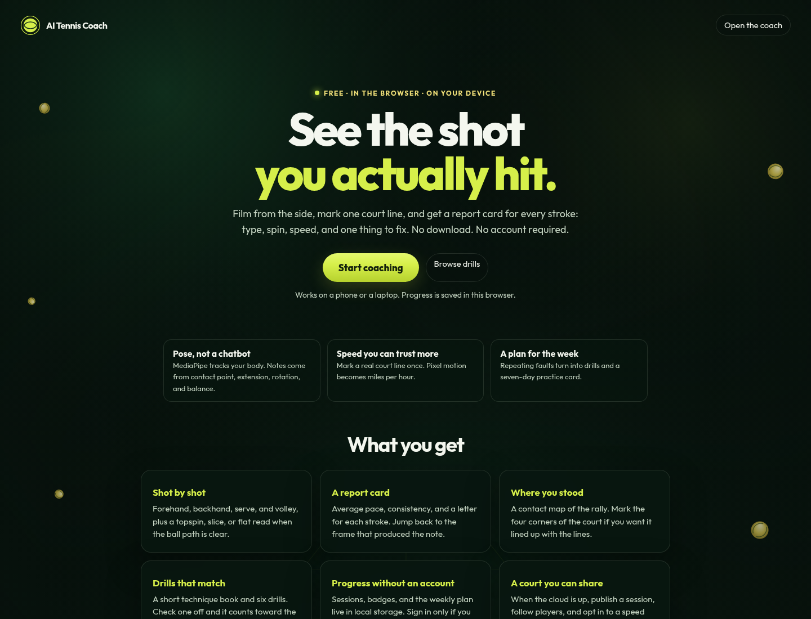
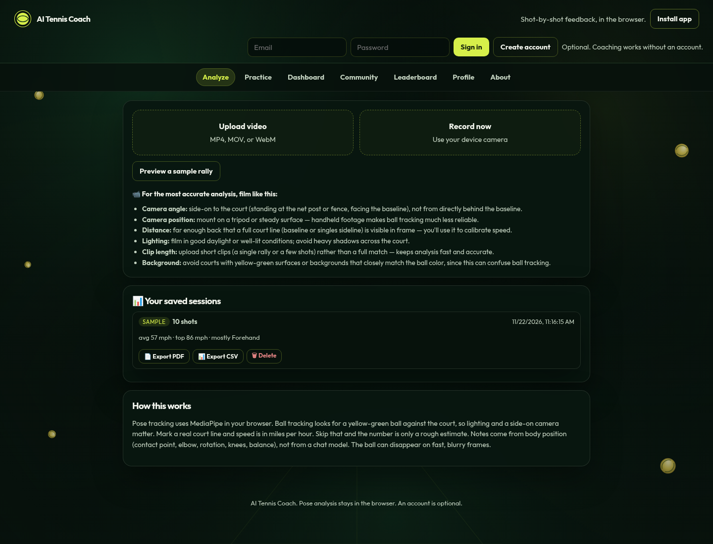
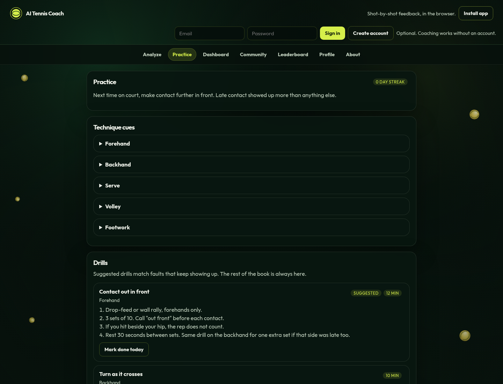
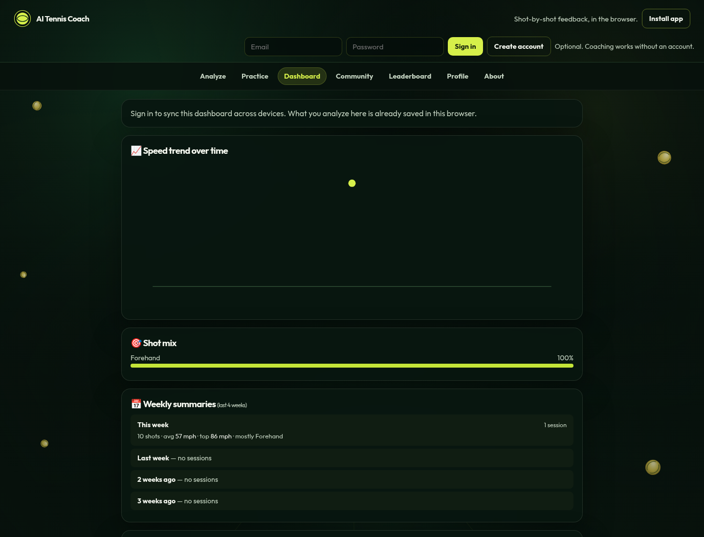
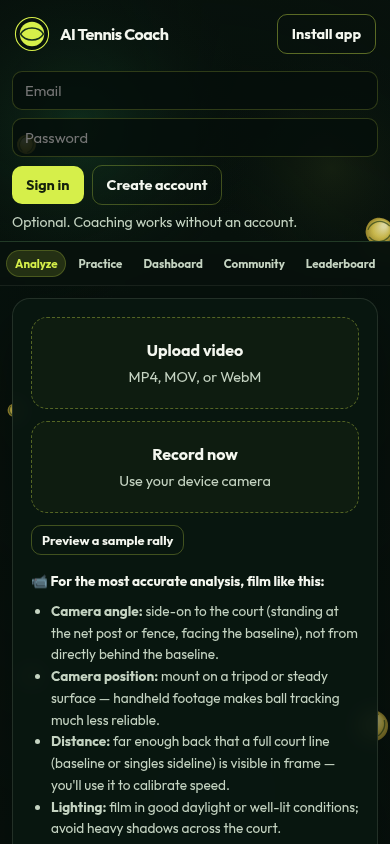

# AI Tennis Coach

A free tennis coach that runs as a static site. Film a rally, mark one court line, and get a shot-by-shot report: stroke type, a spin read, speed in mph, and one thing to fix. Drills, a weekly plan, and your history stay in the browser. An account is optional.

Live: [finpathdev.github.io/onlinetenniscoach](https://finpathdev.github.io/onlinetenniscoach/)



## What you can do

- **Analyze** a video you upload or record in the browser. MediaPipe tracks the body. A color-and-motion pass looks for the ball.
- **Calibrate** with a real court distance (baseline 78 ft, doubles width 36 ft, singles width 27 ft, service-line depth 21 ft, service box 13.5 ft, or a custom length) so speed is in miles per hour.
- **Read a report card** with a letter, consistency, rallies, and a contact map. Click a timestamp to jump back to that frame.
- **Practice** from a short technique book and six drills. Checking one off counts toward a streak on this device. Repeating faults pick the suggested drills and fill a seven-day plan.
- **Keep progress without an account.** Sessions, profile (level and racket hand), and drill check-offs are stored in `localStorage`.
- **Sync when you want to.** Sign in to save sessions to your account, publish one to the community feed, follow players, and opt in to the speed leaderboard.







The phone layout keeps the same flows. Upload and record stack, and every section is in the nav.



## How a session works

1. Film side-on, from the fence, with your whole body and one court line in frame. Short clips work better than a full match.
2. Open **Analyze**, upload the clip or record one, and click both ends of a line whose length you know.
3. Hit **Analyze video**. The skeleton and ball trail play back in the page. Nothing is uploaded unless you later choose to save the video (30 MB max) while signed in.
4. Take the focus line into **Practice**.

**Preview a sample rally** loads a labeled example so you can see the report card, dashboard, and drill suggestions before you film. Delete it from saved sessions whenever you want.

Coaching notes come from pose rules (contact point, elbow extension, shoulder rotation, knee bend, balance). They are not a chat model. Ball speed is only as good as the calibration and the ball track. Fast, blurry frames and yellow-green backgrounds lose the ball. Treat the mph as a coached estimate, not a radar gun.

Left-handed classification uses the racket hand from onboarding or Profile.

## Install and offline

The site is a progressive web app. `manifest.json` starts at `app.html`, and `sw.js` caches the shell under `tennis-coach-v2`.

- HTML, CSS, and JavaScript are **network-first**, then written into the cache, so a refresh picks up a new deploy. The cache is the offline fallback.
- Older caches are deleted when the service worker activates.
- When a new worker is waiting, the page offers a reload.
- The pose model and MediaPipe runtime are cached after the first successful analysis, so a later session can run offline. The first analysis needs a network.
- Supabase requests are never cached.

`prefers-reduced-motion` draws the court background once and turns off transitions. The animation pauses while the tab is hidden.

## Accounts and the cloud

Sign-in, the community feed, comments, follows, and the leaderboard use a Supabase project. The anon key in `app.html` is the public client key. Access to rows is meant to be limited by row level security on that project. There is no service-role key in this repo.

If that project is paused or unreachable, the coach does not break. A banner says cloud sync is offline, and analysis, drills, and history keep saving on the device. Video files are only stored in the cloud when you explicitly save them.

The Supabase project `onlinetenniscoach` was paused when this work started. It was restored so existing accounts can sign in again. If it is paused later, the on-device coach still works.

## Project layout

| File | Role |
| --- | --- |
| `index.html` | Landing page |
| `app.html` | The coach |
| `coach.js` | Shot rules, drills, court distances, sample rally |
| `theme.css` | Shared visual system. Outfit is self-hosted in `fonts/` |
| `bg.js` | Court, mesh, and tennis-ball background |
| `pwa.js` | Service worker registration, update prompt, offline note |
| `sw.js` | App-shell cache (`tennis-coach-v2`) |
| `manifest.json` | Install metadata. Scope is the project folder, so GitHub Pages project sites work |
| `coach.test.mjs` | Unit tests for calibration distances, shot rules, rallies, and the week plan |

No build step. GitHub Pages can serve the folder as-is.

## Run it locally

```bash
python3 -m http.server 8765
```

Open [http://127.0.0.1:8765/](http://127.0.0.1:8765/). Service workers need `http://localhost` or `https://`.

```bash
node coach.test.mjs
```

## Limits

- Ball tracking is a color and motion heuristic, not a trained detector.
- iPhone HEVC (H.265) is refused in browsers that cannot decode it, with a message to export H.264. Portrait clips are sized to the picture, up to 70% of the screen height.
- A screen recording (black bars, a player UI, a tiny player) is called out. Technique notes stay low-confidence instead of inventing a contact or elbow fault. Film the court directly, from the side, if you want a real grade.
- Pose feedback is a set of geometric checks. It will miss things a coach would see, and it can flag a good shot.
- Community features depend on the Supabase project being awake and on its row level security.
- Match records older than three months are removed. Practice sessions are kept.
